# Uzorak za provjeru tačnih odgovora — potpis instruktora

**60 pitanja** od ukupno 421. Generisano sa `python qa/uzorak_za_instruktora.py` (sjeme 20260825, ponovljivo).

Zvanični katalog MUP-a **ne sadrži označene tačne odgovore** — provjereno pretragom
za `(X)`, `[x]`, podvučenim tekstom i riječju „tačan": nula pogodaka na 214 strana.
Zato se tačnost ne može provjeriti programski i traži se stručna potvrda.

Uzorak je stratifikovan — udio po vrsti pitanja odgovara udjelu u bazi:

| Vrsta | U uzorku | U bazi |
| ----- | -------- | ------ |
| situacija | 22 | 180 |
| teorija | 23 | 140 |
| znak | 11 | 77 |
| policajac | 3 | 22 |
| kosnik | 1 | 2 |

## Kako se popunjava

Uz svako pitanje stoji odgovor **koji naša aplikacija smatra tačnim**. Za svako:

- ako je tačan → zaokružiti **DA**
- ako nije → zaokružiti **NE** i upisati koje je slovo tačno

Na kraju: ime, potpis i datum. Bez toga se ne pušta polaznicima.

---

### 1. (id 2)

**Na magistralnom putu van naselja, gdje nema znaka ograničenja brzine, vozač ne smije vozilom da se kreće brzinom većom od:**

- **a)** 60 km/h
- **b)** 70 km/h
- **c)** 80 km/h **← naš odgovor**

Tačno?   **DA**  /  **NE** → tačno je slovo: ______

---

### 2. (id 14)

**Zvučni znak upozorenja vozač je dužan da upotrijebi na javnom putu:**

- **a)** pri sustizanju vozila koja se sporo kreću niz nagib
- **b)** kada se obilazi vozilo parkirano sa desne strane kolovoza
- **c)** kada se pored kolovoza nalaze djeca koja ne obraćaju pažnju na kretanje vozača **← naš odgovor**

Tačno?   **DA**  /  **NE** → tačno je slovo: ______

---

### 3. (id 18)

**Kretanje vozila unazad u uslovima smanjene vidljivosti:**

- **a)** dozvoljeno je u naselju
- **b)** dozvoljeno je na kratkom dijelu puta
- **c)** nije dozvoljeno **← naš odgovor**

Tačno?   **DA**  /  **NE** → tačno je slovo: ______

---

### 4. (id 20)

**Kada vozač naiđe na organizovanu kolonu pješaka koja prelazi kolovoz:**

- **a)** ne smije vozilom da presijeca organizovanu kolonu pješaka **← naš odgovor**
- **b)** smije vozilom da presijeca organizovanu kolonu pješaka uz upotrebu zvučnog znaka upozorenja
- **c)** smije vozilom da presjeca organizovanu kolonu pješaka, ako kolonu ne čine djeca

Tačno?   **DA**  /  **NE** → tačno je slovo: ______

---

### 5. (id 25)

**Naglo mijenjanje brzine vozila po putu je dozvoljeno:**

- **a)** u slučaju uključivanja sa zemljanog puta na javni put
- **b)** u slučaju izbjegavanja neposredne opasnosti **← naš odgovor**
- **c)** u slučaju bržeg isključivanja iz saobraćaja

Tačno?   **DA**  /  **NE** → tačno je slovo: ______

---

### 6. (id 41)

**Prekid kretanja vozila u trajanju dužem od pet minuta, osim prekida koji se vrši da bi se postupilo po znaku ili pravilu kojim se reguliše saobraćaj je:**

- **a)** zaustavljanje vozila
- **b)** parkiranje vozila **← naš odgovor**
- **c)** isključenje vozila

Tačno?   **DA**  /  **NE** → tačno je slovo: ______

---

### 7. (id 47)

**Odstojanje između vučnog i vučenog putničkog vozila, ako se vuče pomoću užeta iznosi:**

- **a)** od 1 do 2 metara
- **b)** od 3 do 5 metara **← naš odgovor**
- **c)** preko 5 metara

Tačno?   **DA**  /  **NE** → tačno je slovo: ______

---

### 8. (id 50)

**U naselju se saobraćajnim znakom motornim vozilima može ograničiti brzina kretanja najviše do:**

- **a)** 80 km/h **← naš odgovor**
- **b)** 50 km/h
- **c)** 60 km/h

Tačno?   **DA**  /  **NE** → tačno je slovo: ______

---

### 9. (id 58)

**Brzina kretanja teretnog vozila sa priključnim vozilom ograničena je na:**

- **a)** 60 km/h
- **b)** 70 km/h **← naš odgovor**
- **c)** 80 km/h

Tačno?   **DA**  /  **NE** → tačno je slovo: ______

---

### 10. (id 66)

**Vozač dok upravlja putničkim motornim vozilom u saobraćaju mora u vozilu:**

- **a)** imati najmanje dva prsluka sa reflektujućim osobinama
- **b)** imati prsluka sa reflektujućim osobinama koliko ima i mjesta za sjedenje
- **c)** imati jedan prsluk sa reflektujućim osobinama **← naš odgovor**

Tačno?   **DA**  /  **NE** → tačno je slovo: ______

---

### 11. (id 70)

**Saobraćajnu traku namijenjenu za kretanje vozila za gradski prevoz putnika mogu koristiti:**

- **a)** vozila za odvoz smeća
- **b)** vozila sa prevenstvom prolaza **← naš odgovor**
- **c)** putnička vozila pri preticanju

Tačno?   **DA**  /  **NE** → tačno je slovo: ______

---

### 12. (id 72)

**Vozač smije da zaustavi ili parkira svoje vozilo na trotoaru:**

- **a)** ako trotoar ima širinu veću od 1,6 metara
- **b)** ako je saobraćajnim znakom dozvoljeno, bez obzira na širinu trotoara i prolaza za pješake
- **c)** ako je dozvoljeno saobraćajnom signalizacijom, i ako ostane prolaz za pješake najmanje širine 1,6 metara, koji ne smije biti uz ivicu kolovoza **← naš odgovor**

Tačno?   **DA**  /  **NE** → tačno je slovo: ______

---

### 13. (id 82)

**Na javnom putu gdje su kolovozne trake fizički odvojene, vozač smije vozilom da se kreće:**

- **a)** kolovoznom trakom namijenjenom za saobraćaj vozila iz suprotnog smjera
- **b)** desnom kolovoznom trakom **← naš odgovor**
- **c)** lijevom i desnom kolovoznom trakom

Tačno?   **DA**  /  **NE** → tačno je slovo: ______

---

### 14. (id 87)

**Kada na raskrsnici vozila dolaze iz suprotnih smjerova i skreću ulijevo mimoilaze se sa:**

- **a)** desne strane **← naš odgovor**
- **b)** lijeve strane
- **c)** lijeve i desne strane

Tačno?   **DA**  /  **NE** → tačno je slovo: ______

---

### 15. (id 89)

**Vozač koji se približava raskrsnici dužan je da:**

- **a)** poveća brzinu kretanja da što brže prođe kroz raskrsnicu
- **b)** prilagodi vožnju uslovima saobraćaja na raskrsnici **← naš odgovor**
- **c)** vozi brzinom koja je propisana opštim ograničenjem

Tačno?   **DA**  /  **NE** → tačno je slovo: ______

---

### 16. (id 90)  ⚠️ **nema u zvaničnom katalogu**

**U bezbjednosnom sjedištu mora da se prevozi dijete do:**

- **a)** 7 godina
- **b)** 6 godina
- **c)** 5 godina **← naš odgovor**

Tačno?   **DA**  /  **NE** → tačno je slovo: ______

---

### 17. (id 91)  ⚠️ **nema u zvaničnom katalogu**

**Na istoj osovini vozila pneumatici moraju da budu jednaki:**

- **a)** po dimenzijama, nosivosti, brzinskim karakteristikama, vrsti, konstrukciji, marki i tipu **← naš odgovor**
- **b)** samo po merki, tipu, dimenzijama, nosivosti, vrsti i dubini šare
- **c)** samo po dimenzijama, marki i tipu

Tačno?   **DA**  /  **NE** → tačno je slovo: ______

---

### 18. (id 92)  ⚠️ **nema u zvaničnom katalogu**

**Svijetla za maglu na motornom vozilu treba da budu postavljena tako da osvjetljavaju put ispred vozila koji nije duži od:**

- **a)** 15 metara
- **b)** 30 metara
- **c)** 35 metara **← naš odgovor**

Tačno?   **DA**  /  **NE** → tačno je slovo: ______

---

### 19. (id 93)  ⚠️ **nema u zvanicnom katalogu; uz to ima i tipfeler: sigurtosni umjesto sigurnosni**

**Naslon za glavu mora biti ugrađen na sjedištu kod kojeg sigurtosni pojas:**

- **a)** je vezan u dvije tačke
- **b)** nije vezan
- **c)** je vezan u tri tačke **← naš odgovor**

Tačno?   **DA**  /  **NE** → tačno je slovo: ______

---

### 20. (id 94)  ⚠️ **nema u zvaničnom katalogu**

**Kad kod povrijeđenog hoćemo da zaustavimo krvarenje upotrebljavamo:**

- **a)** jod i sterilnu gazu
- **b)** kompresivni zavoj **← naš odgovor**
- **c)** alkohol i sterilnu gazu

Tačno?   **DA**  /  **NE** → tačno je slovo: ______

---

### 21. (id 95)  ⚠️ **nema u zvaničnom katalogu**

**Broj hitne pomoći je:**

- **a)** 122
- **b)** 123
- **c)** 124 **← naš odgovor**

Tačno?   **DA**  /  **NE** → tačno je slovo: ______

---

### 22. (id 102)

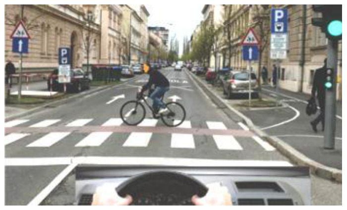

**Ako je biciklista ušao u raskrsnicu na crveno svijetlo na - semaforu u smjeru svog kretanja, kao na slici:**

- **a)** propisno vrši radnju prolaska kroz raskrsnicu
- **b)** nepropisno jer treba da gura biciklo pored sebe
- **c)** nepropisno vrši radnju prolaska kroz raskrsnicu **← naš odgovor**

Tačno?   **DA**  /  **NE** → tačno je slovo: ______

---

### 23. (id 106)

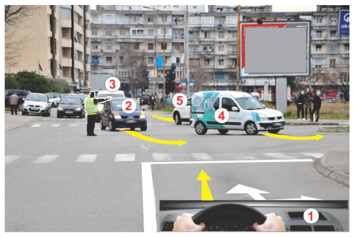

**Kako ćete postupiti u situaciji prikazanoj na slici:**

- **a)** nastaviću kretanje pravo
- **b)** nastaviću kretanje pravo uz propuštanje vozila 4 i 5
- **c)** zaustaviću vozilo **← naš odgovor**

Tačno?   **DA**  /  **NE** → tačno je slovo: ______

---

### 24. (id 119)

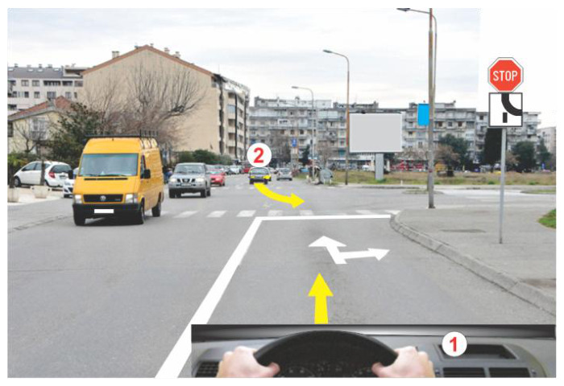

**U situaciji prikazanoj na slici dopunska tabla označava:**

- **a)** nailazak na obilaznicu
- **b)** da se krećem po putu sa prvenstvom prolaza
- **c)** spajanje sa putem sa prvenstvom prolaza **← naš odgovor**

Tačno?   **DA**  /  **NE** → tačno je slovo: ______

---

### 25. (id 121)

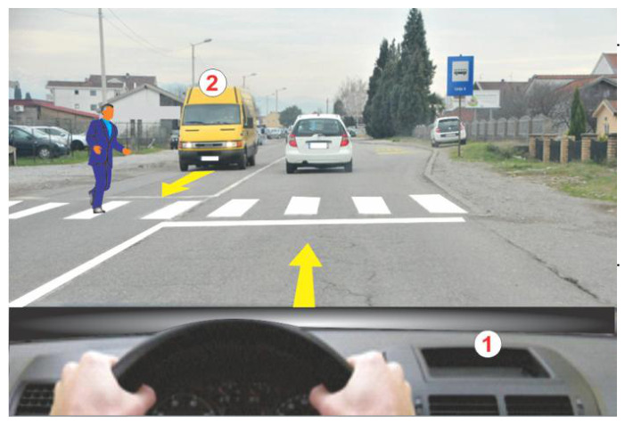

**U situaciji prikazanoj na slici:**

- **a)** nastaviću kretanje pravo ne propuštajući pješaka
- **b)** ubrzaću kretanje vozila i proći ispred pješaka
- **c)** zaustaviću se i propustiti pješaka **← naš odgovor**

Tačno?   **DA**  /  **NE** → tačno je slovo: ______

---

### 26. (id 124)

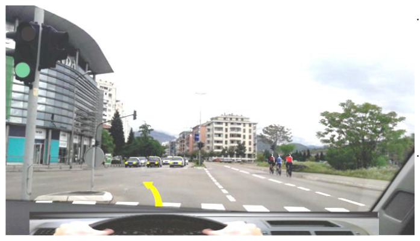

**Kako ćete postupiti u situaciji prikazanoj na slici:**

- **a)** zaustaviću se ispred raskrsnice
- **b)** propustiću vozila iz suprotnog smjera pa nastaviti kretanje **← naš odgovor**
- **c)** nastaviću kretanje ne propuštajući vozila iz suprotnog smjera

Tačno?   **DA**  /  **NE** → tačno je slovo: ______

---

### 27. (id 133)

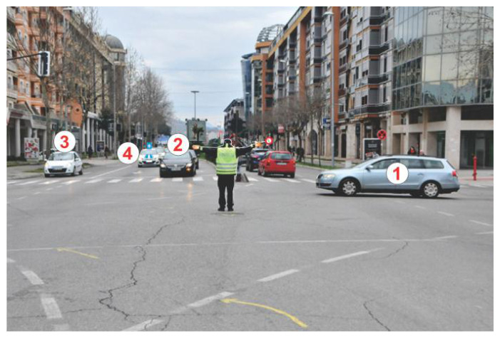

**U situaciji prikazanoj na slici policijsko vozilo 4:**

- **a)** može da nastavi kretanje pravo
- **b)** mora da se zaustavi **← naš odgovor**
- **c)** može da nastavi kretanje pravo nakon prolaska vozila 1

Tačno?   **DA**  /  **NE** → tačno je slovo: ______

---

### 28. (id 143)

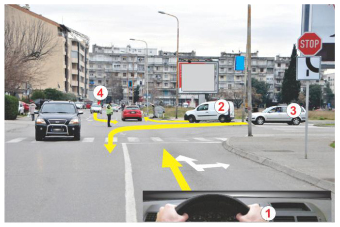

**U situaciji prikazanoj na slici redoslijed prolaska vozila kojima je dozvoljen prolazak je:**

- naš odgovor (redoslijed): **1-4**

Tačno?   **DA**  /  **NE** → tačno je slovo: ______

---

### 29. (id 167)

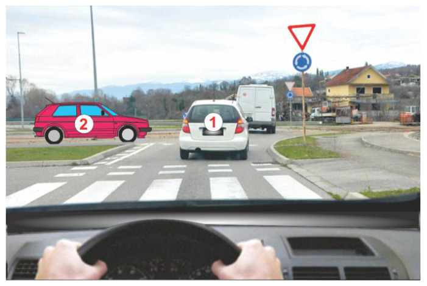

**U situaciji prikazanoj na slici vozač vozila 1 postupiće po:**

- **a)** pravilu propuštanja vozila samo sa desne strane
- **b)** pravilu prolaska kroz neregulisanu raskrsnicu
- **c)** saobraćajnom znakom **← naš odgovor**

Tačno?   **DA**  /  **NE** → tačno je slovo: ______

---

### 30. (id 172)

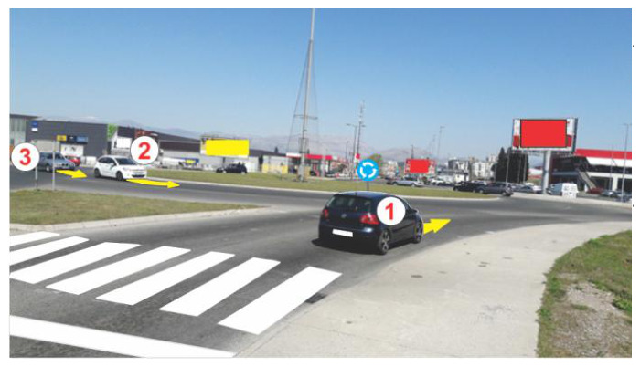

**U situaciji prikazanoj na slici redoslijed prolaska vozila kroz - raskrsnicu je:**

- naš odgovor (redoslijed): **2-3-1**

Tačno?   **DA**  /  **NE** → tačno je slovo: ______

---

### 31. (id 178)

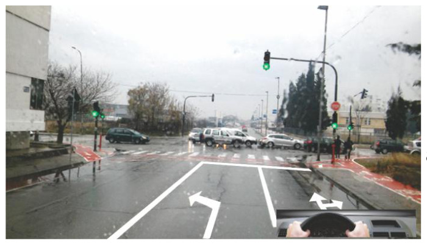

**Kako ćete postupiti u situaciji prikazanoj na slici: * nastaviću kretanje pravo kroz raskrnicu jer, je na semaforu**

- **a)** zeleno svijetlo
- **b)** neću ući u raskrsnicu zbog gustine saobraćaja **← naš odgovor**
- **c)** nastaviću kretanje udesno kroz raskrnicu

Tačno?   **DA**  /  **NE** → tačno je slovo: ______

---

### 32. (id 186)

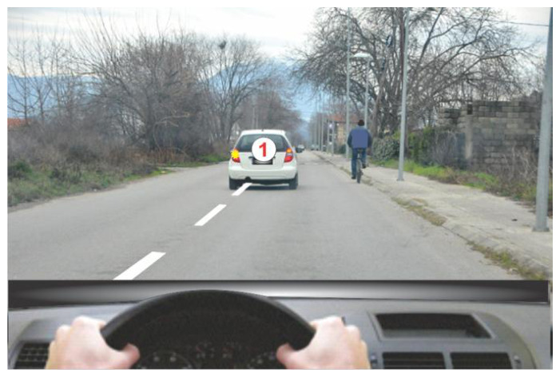

**U situaciji prikazanoj na slici vozilo 1 pretiče biciklistu:**

- **a)** nepropisno, jer prelazi u suprotnu saobraćajnu traku
- **b)** nepropisno, jer ugrožava biciklistu
- **c)** propisno **← naš odgovor**

Tačno?   **DA**  /  **NE** → tačno je slovo: ______

---

### 33. (id 209)

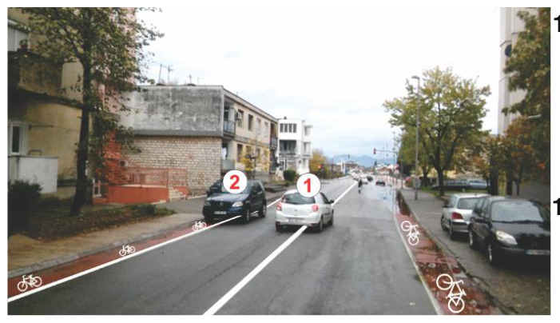

**U situaciji kao na slici putničko vozilo 2:**

- **a)** smije da se zaustavi ili parkira
- **b)** smije da se zaustavi
- **c)** ne smije da se zaustavi ili parkira **← naš odgovor**

Tačno?   **DA**  /  **NE** → tačno je slovo: ______

---

### 34. (id 214)

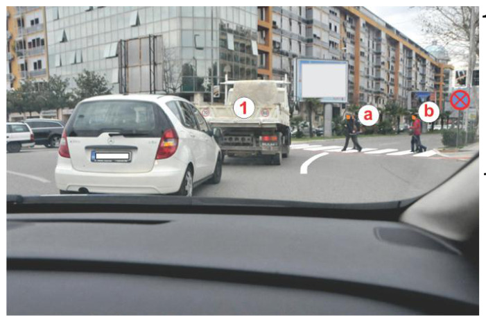

**U situaciji prikazanoj na slici vozač teretnog vozila 1 treba da:**

- **a)** ubrza vozilo i nastavi kretanje ne propuštajuči pješake
- **b)** propusti samo pješaka označenog sa a i nastavi kretanje
- **c)** zaustavi se i propusti sve pješake **← naš odgovor**

Tačno?   **DA**  /  **NE** → tačno je slovo: ______

---

### 35. (id 222)

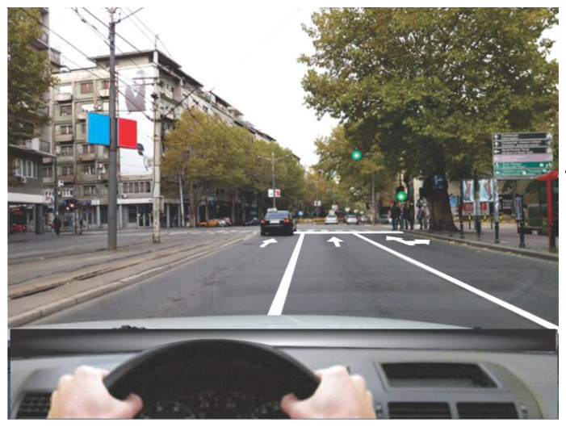

**U situaciji kao na slici:**

- **a)** nastaviću kretanje lijevo kroz raskrsnicu
- **b)** nastaviću kretanje desno kroz raskrsnicu
- **c)** nastaviću kretanje pravo kroz raskrsnicu **← naš odgovor**

Tačno?   **DA**  /  **NE** → tačno je slovo: ______

---

### 36. (id 229)

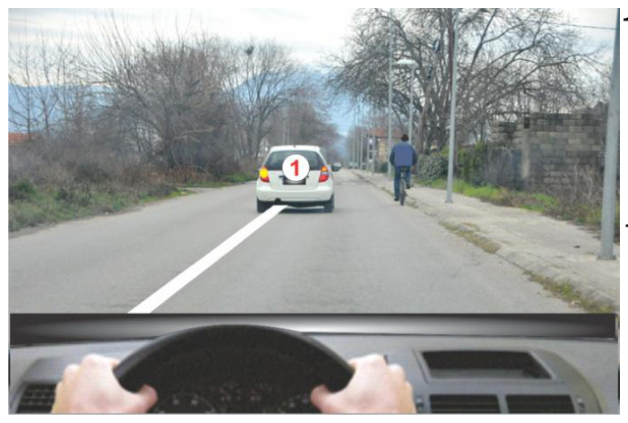

**Biciklista u situaciji na slici u naselju kreće se:**

- **a)** nepropisno, jer treba da se kreće trotoarom
- **b)** nepropisno, jer treba da nosi zaštitnu kacigu
- **c)** propisno uz desnu ivicu kolovoza **← naš odgovor**

Tačno?   **DA**  /  **NE** → tačno je slovo: ______

---

### 37. (id 243)

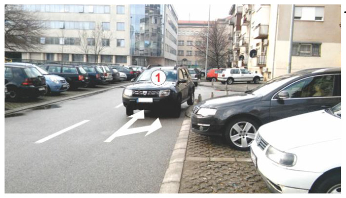

**Vozilo 1 u situaciji prikazanoj na slici je:**

- **a)** na saobraćajnoj traci u smjeru kretanja
- **b)** na saobraćajnoj traci za suprotan smjer kretanja **← naš odgovor**
- **c)** na obilježenom parking mjestu

Tačno?   **DA**  /  **NE** → tačno je slovo: ______

---

### 38. (id 247)

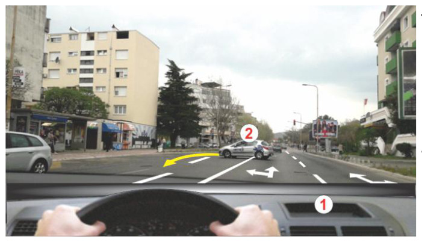

**Uzdužna neisprekidana linija dijeli kolovoz:**

- **a)** na kolovozne trake **← naš odgovor**
- **b)** na saobraćajne trake
- **c)** na dva kolovoza

Tačno?   **DA**  /  **NE** → tačno je slovo: ______

---

### 39. (id 251)

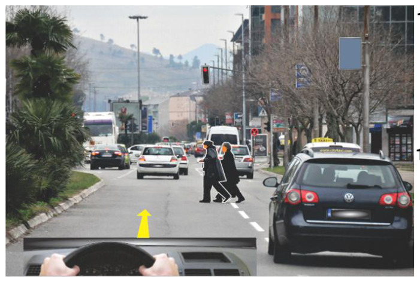

**U situaciji prikazanoj na slici, kada pješaci prelaze kolovoz dužni su da:**

- **a)** kolovoz prelaze najkraćim putem **← naš odgovor**
- **b)** kolovoz prelaze gdje je najmanje učesnika u saobraćaju .
- **c)** kolovoz prelaze što sporije

Tačno?   **DA**  /  **NE** → tačno je slovo: ______

---

### 40. (id 264)

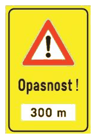

**Na slici je prikazan saobraćajni znak:**

- **a)** opasna dionica puta **← naš odgovor**
- **b)** opasnost na putu
- **c)** opasnost od odrona u dužini od 300 m

Tačno?   **DA**  /  **NE** → tačno je slovo: ______

---

### 41. (id 272)  ⚠️ **opciju b) je parser pokvario — katalog daje drugačiji tekst**

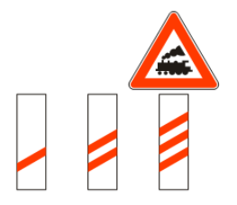

**Na slici je prikazan saobraćajni znak:**

- **a)** prelaz puta preko željezničke pruge sa branicima ili polubranicima
- **b)** približavanje prelaz puta prelasku preko željezničke puta preko pruge željezničke bez branika pruge bez ili branika polubranika ili polubranika **← naš odgovor**
- **c)** približavanje tramvajskoj pruzi

Tačno?   **DA**  /  **NE** → tačno je slovo: ______

---

### 42. (id 279)

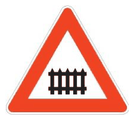

**Na slici je prikazan saobraćajni znak:**

- **a)** prelaz puta preko željezničke pruge bez branika
- **b)** prelaz puta preko željezničke pruge sa branicima ili polubranicima **← naš odgovor**
- **c)** prelaz puta preko željezničke pruge bez branika ili polubranika

Tačno?   **DA**  /  **NE** → tačno je slovo: ______

---

### 43. (id 293)

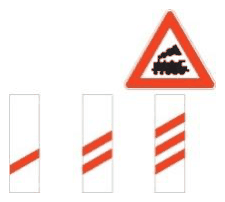

**Na slici je prikazan saobraćajni znak:**

- **a)** približavanje prelazu puta preko željezničke pruge sa branicima ili polubranicima
- **b)** približavanje prelazu puta preko željezničke pruge
- **c)** približavanje prelazu preko željezničke pruge bez branika ili polubranika **← naš odgovor**

Tačno?   **DA**  /  **NE** → tačno je slovo: ______

---

### 44. (id 294)

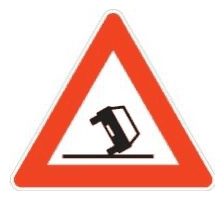

**Na slici je prikazan saobraćajni znak:**

- **a)** prevrtanje ili iskliznuće vozila **← naš odgovor**
- **b)** klizav kolovoz
- **c)** led i poledica na putu

Tačno?   **DA**  /  **NE** → tačno je slovo: ______

---

### 45. (id 302)

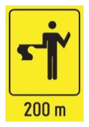

**Na slici je prikazan saobraćajni znak:**

- **a)** predznak za neposredno regulisanje saobraćaja na mjestu na kome se izvode radovi. **← naš odgovor**
- **b)** regulisanje saobraćaja u raskrsnici pomoću zastavice
- **c)** završetak puta zbog izvođenja radova

Tačno?   **DA**  /  **NE** → tačno je slovo: ______

---

### 46. (id 303)

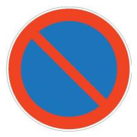

**Na slici je prikazan saobraćajni znak:**

- **a)** zabrana zaustavljanja
- **b)** zabrana saobraćaja u jednom smjeru
- **c)** zabrana parkiranja **← naš odgovor**

Tačno?   **DA**  /  **NE** → tačno je slovo: ______

---

### 47. (id 305)

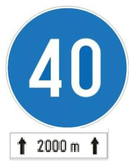

**Na slici su prikazani saobraćajni znaci koji označavaju:**

- **a)** najmanje dozvoljenu brzina u dužini puta od 2000 metara **← naš odgovor**
- **b)** brzinu koja se preporučuje u dužini puta od 2000 metara
- **c)** najmanje dozvoljenu brzinu nakon pređenih 2000 metara

Tačno?   **DA**  /  **NE** → tačno je slovo: ______

---

### 48. (id 307)

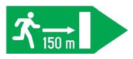

**Na slici je prikazan saobraćajni znak:**

- **a)** obavezan izlaz u slučaju opasnosti
- **b)** udaljenost izlaza u slučaju opasnosti **← naš odgovor**
- **c)** putokaz za pješake

Tačno?   **DA**  /  **NE** → tačno je slovo: ______

---

### 49. (id 318)

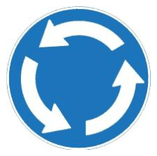

**Na slici je prikazan saobraćajni znak:**

- **a)** kružna raskrsnica
- **b)** raskrsnica sa kružnim tokom saobraćaja
- **c)** kružni tok saobraćaja **← naš odgovor**

Tačno?   **DA**  /  **NE** → tačno je slovo: ______

---

### 50. (id 334)

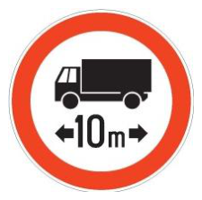

**Na slici je prikazan saobraćajni znak:**

- **a)** zabrana saobraćaja za vozila koja ne prekoračuju određenu dužinu
- **b)** zabrana saobraćaja za vozila koja prekoračuju određenu dužinu **← naš odgovor**
- **c)** zabrana saobraćaja za teretna motorna vozila čija je dužina do 10 metara

Tačno?   **DA**  /  **NE** → tačno je slovo: ______

---

### 51. (id 341)

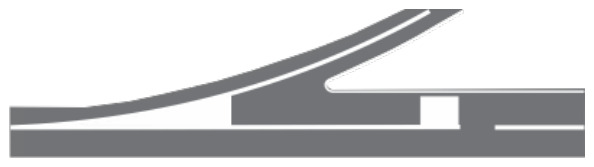

**Na slici je prikazan graničnik koji označava dio kolovoza na kojem je:**

- **a)** zabranjen saobraćaj zbog prepreke na putu
- **b)** zabranjen saobraćaj zbog ulivanja sa prilaznog puta **← naš odgovor**
- **c)** zabranjen saobraćaj zbog završetka saobraćajne trake

Tačno?   **DA**  /  **NE** → tačno je slovo: ______

---

### 52. (id 342)

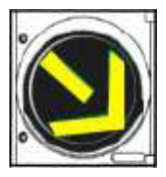

**Na slici je prikazan:**

- **a)** semafor za regulisanje obilaženja sa desne strane
- **b)** semafor za regulisanje prolaska šinskih vozila
- **c)** semafor za regulisanje promjene saobraćajne trake **← naš odgovor**

Tačno?   **DA**  /  **NE** → tačno je slovo: ______

---

### 53. (id 357)

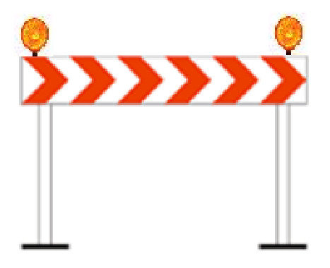

**Privremena saobraćajna signalizacija data na slici označava:**

- **a)** zapreku na putu
- **b)** vertikalnu zapreku
- **c)** usmjeravajući branik **← naš odgovor**

Tačno?   **DA**  /  **NE** → tačno je slovo: ______

---

### 54. (id 362)

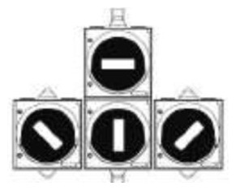

**Ako vozila javnog gradskog prevoza koriste istu saobraćajnu traku kojom se kreću i šinska vozila, uređaj koji je prikazan na slici koristi se za regulisanje kretanja:**

- **a)** tramvaja i autobusa **← naš odgovor**
- **b)** samo autobusa
- **c)** samo tramvaja

Tačno?   **DA**  /  **NE** → tačno je slovo: ______

---

### 55. (id 363)

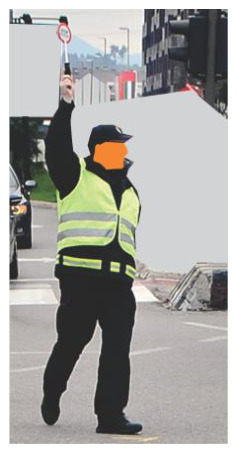

**Kombinovani znak podizanje ruke i upotreba pištaljke, kao na slici, predstavlja:**

- **a)** zabranu prolaza za sve vozače **← naš odgovor**
- **b)** slobodan prolaz za vozila koja dolaze samo sa bočne strane .
- **c)** zabranu prolaza za vozila koja dolaze samo sa bočne strane

Tačno?   **DA**  /  **NE** → tačno je slovo: ______

---

### 56. (id 367)

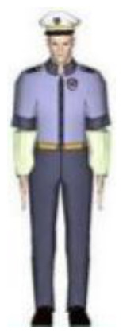

**Položaj tijela policijskog službenika kao na slici, znači da vozila:**

- **a)** koja dolaze sa njegove bočne strane nemaju pravo prolaska
- **b)** da su svi vozači obavezni da zaustave vozilo
- **c)** koja dolaze sa njegove bočne strane imaju pravo prolaska **← naš odgovor**

Tačno?   **DA**  /  **NE** → tačno je slovo: ______

---

### 57. (id 369)

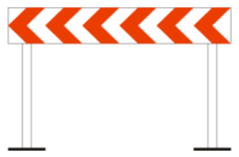

**Na slici je prikazan:**

- **a)** usmjeravajući branik **← naš odgovor**
- **b)** čeoni branik
- **c)** zapreka na putu

Tačno?   **DA**  /  **NE** → tačno je slovo: ______

---

### 58. (id 371)

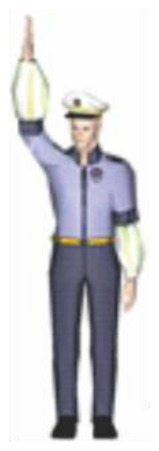

**Vetikalno podignuta ruka, kao na slici znači:**

- **a)** prestanak važenja naredbi koje daje policijski službenik
- **b)** zabranu prolaza za sve vozače u saobraćaju **← naš odgovor**
- **c)** da vozila koja dolaze sa boka imaju slobodan prolaz

Tačno?   **DA**  /  **NE** → tačno je slovo: ______

---

### 59. (id 397)

**Sastavni dio motora sa unutrašnjim sagorijevanjem je:**

- **a)** koljenasto vratilo **← naš odgovor**
- **b)** kardansko vratilo
- **c)** poluvratilo

Tačno?   **DA**  /  **NE** → tačno je slovo: ______

---

### 60. (id 406)

**Kod povrijeđenog lica na ranu se prvo stavlja:**

- **a)** alkohol
- **b)** voda
- **c)** sterilna gaza **← naš odgovor**

Tačno?   **DA**  /  **NE** → tačno je slovo: ______

---

## Potvrda

Potvrđujem da sam pregledao/la gore navedena pitanja i označene odgovore.

Ime i prezime: ______________________________

Zvanje / broj licence: ______________________

Potpis: ____________________   Datum: ____________
